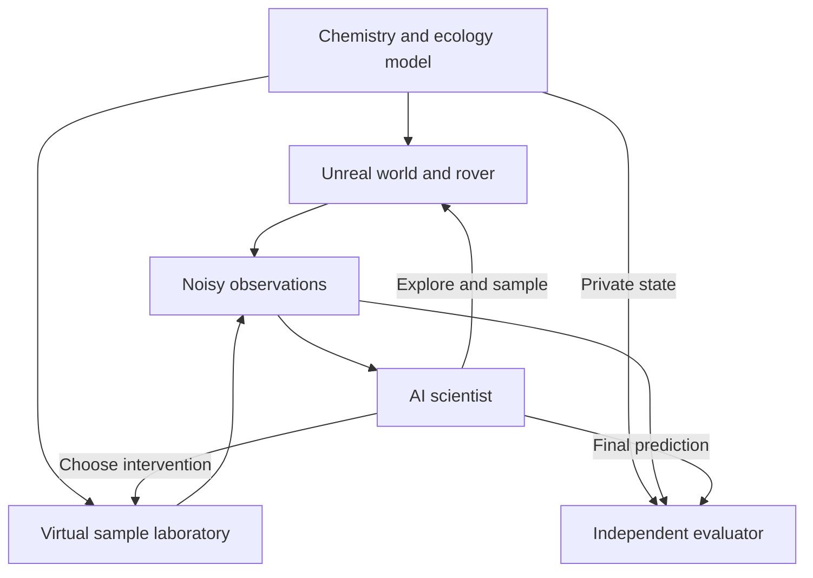
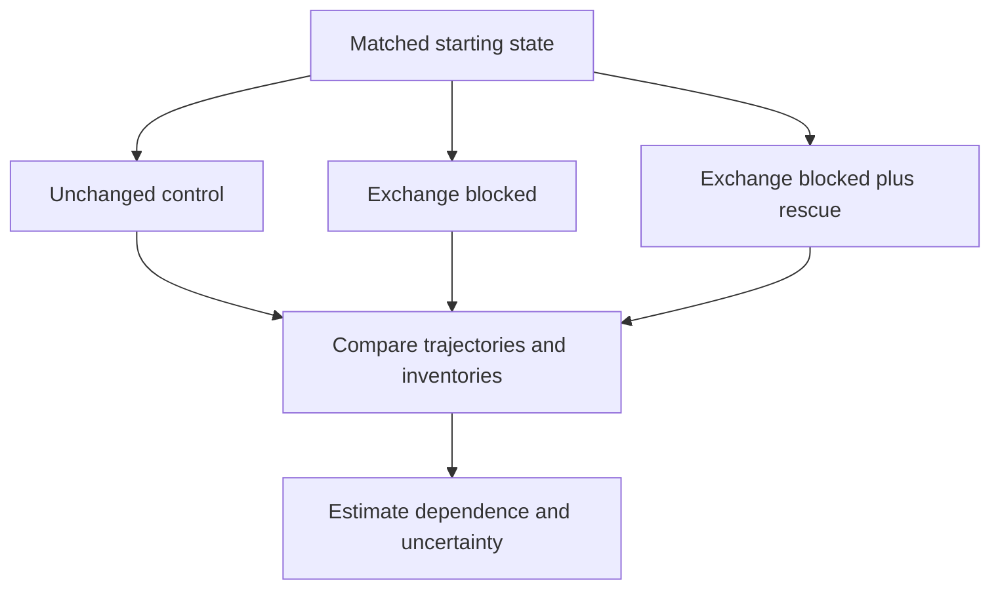
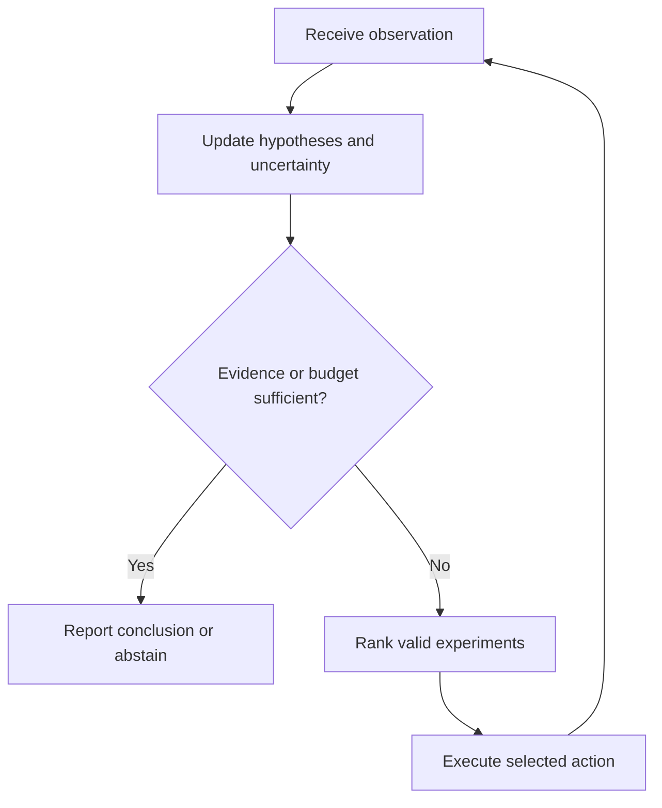

# XENO: Autonomous Astrobiology Discovery World

**A detailed research and implementation blueprint combining XenoGenesis, XenoDetect and XenoLab**

| Document field | Value |
| --- | --- |
| Prepared for | Pardeep Singh |
| Date | 22 October 2026 |
| Version | 1.0 |
| Status | Proposed design; implementation and experimental results are pending |
| Primary output | An Unreal Engine environment, a scientific simulation service, an AI investigator and a reproducible benchmark |
| Research focus | Active investigation of unfamiliar life-like chemical systems |
| Scientific scope | Carbon-dominated models, hypothetical silicon-containing systems, mixed systems and non-living controls |

> **Project in one sentence:** Build a virtual environment in which artificial ecosystems develop, a rover investigates them, and an AI scientist chooses experiments to determine which mechanisms explain the observations.

This is a build specification, not a claim that silicon-based life has been created or demonstrated. Numerical settings below are proposed engineering defaults or illustrative examples unless explicitly identified as measurements from a source. The code blocks describe intended interfaces and configuration formats; they are not a completed application.

## Contents

1. [Vision and research objective](#1-vision-and-research-objective)
2. [Scientific meaning and boundaries](#2-scientific-meaning-and-boundaries)
3. [Novelty and related work](#3-novelty-and-related-work)
4. [Research questions and hypotheses](#4-research-questions-and-hypotheses)
5. [One integrated system](#5-one-integrated-system)
6. [A complete mission](#6-a-complete-mission)
7. [Chemistry and environment model](#7-chemistry-and-environment-model)
8. [Artificial protocells and evolution](#8-artificial-protocells-and-evolution)
9. [Worlds and non-living controls](#9-worlds-and-non-living-controls)
10. [Unreal Engine implementation](#10-unreal-engine-implementation)
11. [Rover, sensors and sampling](#11-rover-sensors-and-sampling)
12. [Virtual laboratory and interventions](#12-virtual-laboratory-and-interventions)
13. [AI scientist and experiment selection](#13-ai-scientist-and-experiment-selection)
14. [Molecular calculations and model fidelity](#14-molecular-calculations-and-model-fidelity)
15. [Runtime contracts and API](#15-runtime-contracts-and-api)
16. [Configuration and data schemas](#16-configuration-and-data-schemas)
17. [Benchmark design](#17-benchmark-design)
18. [Metrics and statistical analysis](#18-metrics-and-statistical-analysis)
19. [Verification and acceptance gates](#19-verification-and-acceptance-gates)
20. [User experience and demonstration](#20-user-experience-and-demonstration)
21. [Technology choices and repository layout](#21-technology-choices-and-repository-layout)
22. [Implementation roadmap](#22-implementation-roadmap)
23. [Compute and performance plan](#23-compute-and-performance-plan)
24. [Risks and decisions](#24-risks-and-decisions)
25. [Research outputs and publication plan](#25-research-outputs-and-publication-plan)
26. [First development sprint](#26-first-development-sprint)
27. [Glossary](#27-glossary)
28. [References and evidence notes](#28-references-and-evidence-notes)

## 1. Vision and research objective

XENO combines three ideas through a single experimental workflow:

- **XenoGenesis** supplies evolving environments and explicit candidate mechanisms.
- **XenoDetect** supplies an embodied investigator that must move, observe and collect samples.
- **XenoLab** supplies controlled experiments and a scientist that updates its explanations.

The investigator has incomplete information. It cannot inspect the underlying reaction network, read a sample's class label or access an unlimited number of measurements. It must spend travel energy, instrument time and sample material to reduce uncertainty.

The main research question is:

> Can active experiments improve identification of unfamiliar life-like mechanisms compared with passive classification, while controlling false positives and the cost of investigation?

The project is valuable even if the answer is negative. A result showing that several candidate mechanisms remain indistinguishable under realistic instrument limits would identify a limitation of the benchmark and its sensors. The objective is reliable investigation, not a predetermined claim of discovery.

### 1.1 Intended users

| User | Main activity | Useful output |
| --- | --- | --- |
| AI researcher | Compare investigation policies under distribution shift | Benchmark scores, uncertainty and failure analysis |
| Computational researcher | Change a reaction model or environmental assumption | Sensitivity analysis and reproducible trajectories |
| Student or developer | Build an end-to-end scientific software project | A working Unreal mission and documented backend |
| Reviewer | Inspect whether an apparent discovery follows from the evidence | Recorded actions, controls and complete model provenance |

### 1.2 Three levels of delivery

**Demonstrator:** One small terrain, one rover, a few explicitly synthetic mechanisms and a complete observation-to-experiment loop.

**Research prototype:** Mechanism-family holdouts, non-living lookalikes, calibrated uncertainty, several baselines and reproducible comparisons.

**Extended platform:** Selected empirically grounded reaction modules, adaptive molecular calculations, richer evolution and additional environments.

Progress between levels depends on verification. Visual polish does not establish readiness for scientific claims.

## 2. Scientific meaning and boundaries

### 2.1 Distinguish four different ideas

| Term | Meaning in XENO | Permitted interpretation |
| --- | --- | --- |
| Carbon-dominated system | Model whose specified molecular networks principally use carbon chemistry | A simplified model with a documented scope |
| Silicon-containing system | Network containing selected silicon species or reactions | A candidate model; not a known silicon organism |
| Artificial life | Software entities with explicit maintenance, inheritance or replication rules | Behaviour within the implemented rules |
| Biological life | Real organisms whose biology is supported by observations | Not established by a simulation label |

All known biological life is carbon-based. Silicon's behaviour depends strongly on its chemical environment; silica formation and solvent compatibility constrain simple replacements of carbon chemistry. Alternative solvents can change the available chemistry, but do not establish a complete alternative biology. [R1]

Engineered enzymes have been reported to form carbon–silicon bonds, and separate work has demonstrated cleavage of silicon–carbon bonds in certain siloxanes. Those are specific biochemical capabilities. They do not demonstrate an organism whose main biochemical framework is silicon. [R4, R5]

### 2.2 Evidence classification

Every species, reaction, parameter and sensor model must have an evidence class.

| Evidence class | Required record | Use |
| --- | --- | --- |
| `measured` | Source, conditions, units and uncertainty if available | Calibrated components within their supported conditions |
| `computed` | Method, software version, inputs, convergence and validation | Approximate predictions with documented applicability |
| `hypothetical` | Explicit assumption and chosen parameter range | Artificial-life experiments and sensitivity analysis |
| `unknown` | Missing information and reason | Disabled calculation or an explicit uncertainty gap |

A network can contain several classes. Its aggregate evidence status must expose the weakest assumptions supporting a claim. A single measured reaction does not make an entire hypothetical metabolism empirically validated.

### 2.3 Operational labels

The evaluator should use several mechanism properties rather than a universal `is_alive` flag:

- Maintains a specified inventory under ongoing resource supply.
- Recovers from a defined perturbation within a defined interval.
- Produces descendants under the implemented reproduction rule.
- Transmits variable traits between generations.
- Depends on another population through an identified exchange pathway.

For a binary benchmark, define a narrower target such as `implemented_protocell_mechanism_present`. Freeze its definition before training. Also retain the separate property labels, because mechanisms can be mixed or ambiguous.

Allowed investigator outcomes are `candidate_mechanism_supported`, `abiotic_explanation_supported` and `inconclusive`. Any probability concerns the benchmark hypotheses under the assumed models, not the probability of extraterrestrial life in nature.

### 2.4 Initial exclusions

Version 1 does not attempt abiogenesis, silicon DNA, consciousness, an atom-by-atom planet, accurate planetary climate, or a universal life detector. Protocell replication is an explicit rule. Any later claim of emergent replication would require a separate experiment with that rule removed.

## 3. Novelty and related work

The principal contribution to pursue is **an experiment-selection method evaluated in an embodied benchmark where the test mechanisms differ from the training mechanisms**.

The integration of several tools is useful engineering. Originality would come from a clearly defined method, dataset design or result that advances existing work.

| Existing direction | Relevant foundation | Proposed XENO extension | Evidence needed |
| --- | --- | --- | --- |
| Automated artificial-life search | ASAL searches for interesting behaviour across several ALife substrates [R2] | Use explicit chemical inventories and causal interventions to investigate discovered behaviour | Compare behaviour-only search with the constrained version |
| AI life detection | Artificial-life experiments demonstrate confident false positives on unfamiliar inputs [R3] | Let an investigator choose follow-up experiments and abstain | Test on withheld mechanisms and challenging non-living controls |
| Silicon biocatalysis | Specific bond formation and cleavage reactions have been demonstrated [R4, R5] | Incorporate selected reactions with provenance and calibrated uncertainty | Reproduce reference behaviour before building wider networks |
| Embodied machine learning | Unreal provides tools for learned character control [R8] | Evaluate scientific sampling decisions with travel and instrument costs | Separate navigation performance from reasoning performance |

### 3.1 Candidate contributions

**Primary:** A cost-aware policy that selects observations and interventions to distinguish competing mechanism hypotheses under distribution shift.

**Secondary:** A benchmark with held-out reaction families, independent visual appearance, difficult abiotic controls and explicit uncertainty.

**Optional extension:** A policy that decides when an additional molecular calculation is worth its computational cost.

**Optional ecological extension:** Robust evidence for modelled cross-feeding, tested through intervention and rescue experiments.

### 3.2 Novelty verification procedure

Before claiming originality, search work on active life detection, agnostic biosignatures, autonomous scientific experimentation, artificial chemistry, embodied experimental design and adaptive simulation fidelity. Record the closest systems, their tasks, action spaces, data, metrics and assumptions. Narrow the claim if a close predecessor exists.

The references in this document are a starting set, not an exhaustive novelty review. No first-ever claim is made here.

## 4. Research questions and hypotheses

| ID | Question | Hypothesis to test | Comparison |
| --- | --- | --- | --- |
| RQ1 | Do interventions improve inference? | An active policy reduces false positives at a matched detection sensitivity | Passive classifier versus active policy |
| RQ2 | Does the policy transfer to new mechanisms? | Mechanism-aware features retain more performance than visual shortcuts | Held-out families and independently randomised appearance |
| RQ3 | Can it use a limited budget well? | Information-aware selection achieves a better error–cost trade-off | Random actions and a simple adaptive baseline |
| RQ4 | Is an apparent cooperative relationship causal? | Removing a proposed exchange changes persistence, with appropriate controls | Joint, isolated, blocked-exchange and rescue conditions |
| RQ5 | Are additional calculations worth their cost? | Selective refinement improves decisions more efficiently than uniformly refining every case | Multi-fidelity policy versus fixed-fidelity policies |

RQ1 is the initial paper focus. RQ2 and RQ3 are required evaluation dimensions. RQ4 and RQ5 can become later studies. These are hypotheses, not expected results guaranteed by the design.

## 5. One integrated system

### 5.1 Data ownership

| Component | Owns | Must not expose to the investigator |
| --- | --- | --- |
| World simulator | Inventories, reaction state, population state and external forcing | Hidden mechanism identifiers and exact unobserved fields |
| Unreal runtime | Rover pose, collisions, camera production and interaction | Authoring tags that encode the answer |
| Observation service | Sensor forward models, noise and detection limits | Noise seeds and private simulator references |
| Sample laboratory | Sample amounts, chamber conditions and intervention execution | Hidden sample class or privileged diagnostic results |
| AI scientist | Observation history, hypotheses and chosen actions | It receives no evaluator credentials |
| Evaluator | Ground truth, dataset split membership and scoring | Labels during an evaluation episode |



### 5.2 Authority and timing

The simulation service owns scientific time and material inventories. Unreal owns the rover's immediate movement and visual presentation. A coordinator reconciles movement events, sample transfers and scientific updates at defined decision boundaries.

Use three clocks: solver substeps, mission simulation time and wall-clock execution time. Record all three where relevant. The chemistry should not advance once per rendered frame.

During a turn, the agent submits one action with a unique identifier and an expected state revision. The coordinator validates feasibility, commits costs and effects once, advances the required simulation interval and returns the resulting observation. Repeating the same action identifier returns the original result rather than consuming a second sample.

### 5.3 Modes

| Mode | Purpose | Access |
| --- | --- | --- |
| Authoring | Develop mechanisms and inspect full fields | Privileged developer |
| Benchmark | Evaluate an investigator with restricted observations | Agent-facing API only |
| Replay | Inspect recorded trajectories and decisions | Read-only records |
| Teaching | Explain a recorded experiment with hidden mechanisms revealed | Explicitly marked educational view |

Use separate runtime data structures for privileged state and investigator observations. Hiding a field in the user interface is insufficient if it remains available through an API or an asset name.

## 6. A complete mission

The following is an illustrative scenario, not a simulated result already obtained.

1. A world is generated from a frozen mechanism template. It contains two artificial populations, a mineral-growth process and an external resource gradient.
2. The rover begins with a limited battery, instrument budget and sample capacity. It sees terrain and instrument observations, but not mechanism labels.
3. A repeated image survey reveals a branching structure. A local chemical reading shows a change in several measured channels.
4. The investigator considers mineral deposition, a single maintenance mechanism and cross-feeding as possible explanations.
5. It collects a finite sample. The material is removed from the environment and entered into the laboratory inventory.
6. It divides the sample into a control and an intervention chamber. Both allocations reduce the available sample amount.
7. It changes resource supply in one chamber, records the time series and compares it with the unchanged control.
8. A second experiment tests separation or a supported selective intervention. A rescue experiment adds the proposed exchanged product when the action catalogue permits it.
9. The investigator updates its hypotheses and records unresolved alternatives.
10. It reports a conclusion or abstains. The evaluator scores the frozen prediction after the episode ends.

An impressive demo should show both a successful investigation and a plausible case where the correct decision is to remain uncertain.

## 7. Chemistry and environment model

### 7.1 State representation

Begin with a two-dimensional spatial grid representing a thin layer of material with a specified thickness. The scientific geometry can be much smaller than the Unreal landscape. A documented coordinate transformation connects sample sites to grid cells; a cinematic overview is not the same as a physical scale model.

Each cell stores species concentrations, temperature, environmental resource fluxes and any local population inventory. Derive amounts from concentration and cell volume. Store phase information separately for dissolved species, gases, precipitates and material held inside protocells.

| Quantity | Suggested internal unit | Rule |
| --- | --- | --- |
| Time | s | Scientific and rendering clocks are separate |
| Length | m | Convert explicitly at the Unreal boundary |
| Concentration | mol/m³ | Record the corresponding compartment volume |
| Amount | mol | Use for transfers and conservation checks |
| Temperature | K | Convert display values only at the interface |
| Pressure | Pa | A parameter within a supported model domain |
| Energy | J | Distinguish physical energy from abstract fitness units |
| Diffusivity | m²/s | Document medium and temperature dependence |

### 7.2 Reaction and transport equations

For species concentrations collected into a vector c, a starting model is:

$$
\frac{\partial \mathbf{c}}{\partial t}
= \mathbf{S}\mathbf{v}(\mathbf{c},T)
+ \nabla\cdot(\mathbf{D}\nabla\mathbf{c})
+ \mathbf{f}_{in}-\mathbf{f}_{out}-\mathbf{u}_{cells}.
$$

Here S is the species-by-reaction stoichiometric matrix, v is the reaction-rate vector, D contains transport coefficients, and the remaining terms represent declared exchanges. Every uptake term must have a matching addition to another inventory or an explicitly represented product.

A mass-action expression for a suitable elementary or effective reaction is:

$$
v_j = k_j\prod_i c_i^{\alpha_{ij}}.
$$

The units of k depend on the reaction order. Do not assign the same rate-constant units to every reaction. Effective biological uptake laws require their own interpretation and validation; a formal chemical equation alone does not determine its kinetics.

Use measured rate laws where available. Otherwise choose an explicitly hypothetical family of rates and study its sensitivity. Missing kinetics must not silently become invented experimental measurements.

### 7.3 Element and charge balance

Let A contain element counts for each species and q contain species charges. For a closed, balanced reaction network:

$$
\mathbf{A}\mathbf{S}=0, \qquad \mathbf{q}^{T}\mathbf{S}=0.
$$

For open systems, reconcile changes against all logged inputs, outputs and transfers. Internal transfers between the world, a sample container and a lab chamber cancel when the total inventory is calculated.

Explicitly include precipitates and waste. A decrease in dissolved material is not disappearance of atoms. Abstract coarse-grained resources can use conserved resource tokens, but such a model must be labelled as token accounting rather than atomically resolved chemistry.

### 7.4 Thermodynamics and the maintenance budget

Where supported, assess a reaction using:

$$
\Delta_r G = \Delta_r G^{\circ} + RT\ln Q.
$$

Q is formed from dimensionless activities. The standard state, solvent and conditions must be consistent. This evaluates thermodynamic tendency; it does not supply an activation barrier or reaction time. Avoid comparing raw total electronic energies of chemically different molecules as a measure of which is more viable.

For a reversible model intended to represent equilibrium, maintain the required relationship between forward and reverse kinetics and the equilibrium constant. Randomly varying both rates independently can create an inconsistent model. External driving, such as an imposed resource flux, must be explicit.

Version 1 may use a maintenance budget for artificial protocells:

$$
B_{t+\Delta t}=B_t+U_t-M_t-R_t-D_t.
$$

U is acquired budget, M maintenance, R repair and D division expenditure. If these are abstract units, call them budget units. Do not describe this equation as a full thermodynamic energy-conservation model. Quantitative heat conservation requires an additional enthalpy and heat-transfer model.

### 7.5 Numerical integration

Separate transport and local reaction updates initially, with a documented operator-splitting order. Check both time-step and spatial-resolution convergence. Small, non-stiff systems can use explicit integration; stiff reaction networks may require an implicit method. SciPy documents `Radau` and `BDF` as options for stiff problems. [R11]

Negative concentrations require a documented policy. Reject unstable steps or use an appropriate positivity-preserving formulation. Silent clipping can create or destroy material. If negligible floating-point corrections are applied, log their total magnitude and include them in the numerical-error report.

### 7.6 Environment validity

Start with a supported aqueous temperature and pressure range. Reject conditions outside that range unless an appropriate phase and chemical model is implemented. A solvent selector must select a different validated model; changing a label or dielectric constant does not reproduce all solvent chemistry.

Treat concentrated acid environments, cryogenic liquids, detailed oxygen exchange and variable pH as separate extensions. A pH control needs a chemically consistent intervention and charge/speciation treatment. An arbitrary pH slider disconnected from the species inventory is unsuitable for the scientific benchmark.

## 8. Artificial protocells and evolution

### 8.1 Protocell state

Each protocell has a position, internal resource inventory, maintenance budget, damage level, transport traits, catalytic allocation, lineage identifier and a replication-rule identifier. Trait limits belong to its mechanism family.

Each update performs resource exchange, internal reactions or declared effective transformations, maintenance, damage/repair, and a possible division or failure event. On division, partition the parent's inventory and charge the division cost. On failure, release or transform its material according to an explicit rule.

Traits may mutate within supported parameter ranges. Evolution must not freely change atomic composition, the laws of conservation or the sign of a reaction's free energy. If the model permits changes in catalytic rates, preserve any required thermodynamic relationships.

### 8.2 Carbon and silicon comparisons

Do not assign a global multiplier that makes carbon always win or silicon automatically thrive at high temperature. Compare specified networks with matched access to relevant resources and document the differences in model evidence.

Track two independent labels: **chemical composition family** and **behavioural mechanism**. A silicon-rich mineral is an abiotic control; a carbon-rich sample can also be abiotic. Neither element is an answer label.

The initial silicon-containing protocell is an artificial-life hypothesis with declared uncertain parameters. The main question is how the investigator handles that uncertainty, not whether its survival proves that a corresponding organism is feasible.

### 8.3 Cooperation and cross-feeding

Cross-feeding means that a product generated by one population becomes an input useful to another. A demonstration should examine both directions separately; one-way dependence is not automatically mutual benefit.

Run populations alone and together, then compare a selectively blocked exchange with an appropriate control. Test a rescue condition when the proposed exchanged material can be supplied through the action catalogue. Control for separation effects such as altered diffusion, density or access to external nutrients.

Measure persistence, growth, exchanged amounts and sensitivity to uncertain kinetics. A single attractive trajectory is not enough to establish robust cooperation.



Privileged checkpoint branches are for developer analysis. An investigator in the benchmark must perform allowed, budgeted operations on real simulated aliquots; it cannot duplicate material or access a free counterfactual oracle.

## 9. Worlds and non-living controls

### 9.1 Initial world families

| Family | Mechanism | Why it is useful |
| --- | --- | --- |
| Resource-limited protocells | Explicit maintenance and division rules | Simple positive mechanism for debugging |
| Dependent protocell pair | Declared exchange of required products | Tests inference about cooperation |
| Mineral deposition | Supported or explicitly phenomenological precipitation/growth | Tests whether visible growth is overinterpreted |
| Abiotic chemical dynamics | Non-living reaction and transport processes | Tests whether changing chemistry is overinterpreted |
| Mixed sample | Protocells and abiotic material together | Tests misleading background signals |
| Dormant or damaged system | Low activity despite an implemented mechanism | Tests false negatives and abstention |

For the first demonstration, implement two protocell mechanisms and two abiotic mechanisms. The larger benchmark must contain additional independently designed families.

### 9.2 Procedural generation

Generate physical parameters and chemical mechanisms first. Independently sample visual parameters such as colour, mesh variation, lighting and camera conditions. Ensure train and test sets cannot be distinguished through filenames, object identifiers, terrain themes or asset bundles.

A procedural seed should have separate derived streams for mechanism parameters, environmental forcing, visuals and sensor noise. Keep all seed information private during evaluation.

Reject invalid configurations before a policy is assigned. Log rejection rates and reasons. Do not retain only worlds where a proposed method succeeds.

### 9.3 Environmental challenges

Useful challenges include gradual resource depletion, intermittent driving, diffusion barriers, mixed samples, sensor drift and partial observation. Add one challenge at a time so that a failure can be traced to a specific source.

Temperature, pressure and solvent settings must remain within the relevant model's validity domain. A visually alien biome can use a simple supported scientific model while clearly identifying the artistic elements.

## 10. Unreal Engine implementation

### 10.1 Responsibility split

Use Unreal for navigation, collision handling, cameras, sample interactions, overlays and presentation. The external scientific service computes chemical states and laboratory responses. This allows numerical experiments to run without rendering and the visual world to replay recorded results.

Niagara supports particle systems and external data interfaces, making it suitable for displaying selected concentration or population fields. Its artistic simulation settings must not become unvalidated chemical rules. [R6]

### 10.2 Proposed runtime components

The following are project class names to implement, not existing Epic APIs.

| Proposed component | Responsibility |
| --- | --- |
| `AXenoRoverPawn` | Rover movement, collision and interaction state |
| `UXenoSimulationBridge` | Connection lifecycle, protocol version and message processing |
| `UXenoSensorComponent` | Camera capture and requests for instrument observations |
| `UXenoSampleInventory` | Containers, capacity and observed sample metadata |
| `AXenoSampleSite` | Physical sample location and interaction geometry |
| `UXenoFieldDisplay` | Convert approved field data into textures or visual overlays |
| `UXenoMissionInterface` | Budget, observations, hypotheses and action history |
| `UXenoReplayController` | Replay recorded states without rerunning a live policy |

Keep scientific identifiers separate from asset names. Actor tags and material choices must not reveal whether a site contains a target mechanism.

### 10.3 Python integration constraint

Epic's built-in Python scripting is intended for the Unreal Editor and asset workflows, not packaged gameplay execution. Therefore, run the Python scientist and simulation as an external process. Connect through a runtime C++ bridge using a documented protocol. [R9]

Use the runtime WebSockets module for streaming observations and command results. HTTP can handle episode setup and large metadata requests. Epic documents WebSockets as a runtime module. [R10]

The minimum deliverable should include an early packaged-build smoke test. A feature that works only inside the editor is not sufficient evidence that the runtime architecture works.

### 10.4 Rendering strategy

Display concentrations through downsampled textures, instanced markers or a limited number of particle systems. A rendered particle can represent an aggregate amount; do not imply that every visible particle is a physically simulated molecule.

Use a local microscope view for small structures and a mapped overview for the landscape. Label magnification and scale transformations. Keep authoring-only heatmaps and hidden population labels out of the benchmark camera feed.

Begin with a compact map and moderate visual quality. Dynamic weather, elaborate volumetrics, VR and cinematic lighting are later features with no role in the initial scientific acceptance gate.

### 10.5 Rover control

Begin with deterministic navigation and a small action set so scientific reasoning can be evaluated separately. Add learned locomotion only after the investigation policy is working.

Epic's Learning Agents plugin supports reinforcement and imitation learning, but is marked experimental. Treat it as an optional adapter and pin the engine/plugin combination after a smoke test. It is not required for the initial benchmark. [R8]

## 11. Rover, sensors and sampling

### 11.1 Action catalogue

| Action | Cost | Preconditions | Result |
| --- | --- | --- | --- |
| Move to location | Travel time and battery | Reachable path | Updated position and mission clock |
| Observe site | Instrument time and optional energy | Suitable range or line of sight | Image or local instrument reading |
| Collect sample | Time, container capacity and material | Site accessible and enough material | New sample inventory entry |
| Split sample | Material allocation and handling time | Sufficient amount and empty chamber | Two traceable aliquots |
| Run intervention | Reagents, energy and laboratory time | Supported mechanism and valid conditions | Time series or endpoint measurement |
| Wait and measure | Mission time and instrument budget | Active sample or site | Longitudinal observation |
| Submit conclusion | Remaining mission terminates | Valid report schema | Frozen prediction for scoring |

Choose a cost model before evaluation. Report travel, laboratory and compute costs separately as well as any combined utility score. A policy can otherwise appear efficient by moving costs into an uncounted category.

### 11.2 Observation model

Represent observations as:

$$
o_t = h(s_t,a_t;\phi)+\epsilon_t,
$$

where h is a declared instrument model, phi describes its characteristics and epsilon is noise. The agent receives o, not the full state s.

Version 1 should use camera images plus a small set of synthetic concentration channels and temperature readings. Give each channel a unit, detection limit, uncertainty model and sampling interval. Below-limit measurements should be marked as censored, not converted into exact zeros.

Do not label arbitrary random vectors as mass spectra or Raman spectra. Such instruments require their own justified forward model and reference validation. Real sensor data can be added later without claiming that it validates every synthetic mechanism.

### 11.3 Sampling integrity

Sampling removes material from the source and adds it to a container. A lab split partitions that amount. Record handling losses, if modelled, as explicit transfers to waste.

Transport can change temperature or permit continued reactions. Either simulate these effects or explicitly state that the initial prototype uses an idealised preservation assumption. Applying a preservation assumption consistently is preferable to an undocumented mechanism-dependent transport rule.

### 11.4 Navigation as an experimental factor

Evaluate a common-navigation setting first: all investigators receive the same navigation controller. Later compare policies with their own exploration strategies. This prevents improved route planning from being mistaken for better chemical inference.

## 12. Virtual laboratory and interventions

The laboratory owns finite sample compartments. It uses the same declared mechanism definitions as the world, with the relevant geometry, transport and boundary conditions changed explicitly. Document effects introduced by isolation from the environment.

| Intervention | Purpose | Necessary control |
| --- | --- | --- |
| Change a supported energy/resource input | Test dependence on a proposed driver | Matched handling with the input unchanged |
| Remove or reduce a reactant | Test a proposed pathway | Comparable dilution or handling control |
| Separate populations | Test dependence on co-location or exchange | Control for density, transport and nutrient changes |
| Block an allowed exchange mechanism | Test the mechanism specifically | Check unintended effects on other pathways |
| Supply a proposed exchanged product | Test a rescue prediction | Same addition to an appropriate control sample |
| Repeat at a supported temperature | Test model predictions across conditions | Matched initial material and calibrated sensors |

The investigator may choose only interventions available through the instrument catalogue. Arbitrarily deleting a hidden reaction is an evaluator operation, not a realistic agent action. If a selective inhibitor is simulated, its selectivity and side effects must be represented and disclosed as assumptions.

### 12.1 Paired experiments

For agent experiments, allocate real simulated aliquots and charge their costs. For developer analysis, use a checkpoint and preserve the same exogenous forcing where meaningful. Separate random streams by subsystem; a shared seed alone does not guarantee comparable randomness when branches execute different events.

Predefine the measurement interval and endpoint. Record failed interventions and exhausted samples rather than quietly replacing them with convenient results.

### 12.2 Lab record

Each experiment stores the source sample, aliquot amounts, initial state reference, requested action, actual applied conditions, control relationship, observation times, model version, numerical diagnostics and a validity status. The investigator receives only the allowed subset of this record.

## 13. AI scientist and experiment selection

### 13.1 Start with a compact investigator

The first investigator should use a small library of hypotheses and a transparent belief-update method. Add language-model planning only after this baseline works. The project does not require an LLM for every molecule, cell or simulation tick.

| Logical role | Input | Output |
| --- | --- | --- |
| Observation processor | Instrument results and their uncertainty | Features or time-series representation |
| Hypothesis manager | Evidence history and candidate models | Current belief or model-disagreement state |
| Experiment selector | Beliefs, valid actions and remaining budget | Next action and a concise rationale |
| Numerical executor | Validated action request | Tool-produced measurements |
| Evidence critic | Claims and cited experiment records | Unsupported claims or missing controls |
| Reporter | Frozen evidence state | Conclusion, limitations and suggested next measurement |

These are software roles, not a requirement to deploy separate LLM agents. Start with one orchestration process and explicit state. Multiple model calls should be justified by measured benefit.

### 13.2 Action-selection objective

A useful starting objective is expected information gain minus action cost:

$$
a^* = \arg\max_{a\in\mathcal{A}_{valid}}
\left[\operatorname{EIG}(a)-\lambda^T\operatorname{cost}(a)\right].
$$

For hypothesis H and observed history D:

$$
\operatorname{EIG}(a)=\mathcal{H}[p(H\mid D)]
-\mathbb{E}_{o\sim p(o\mid a,D)}\mathcal{H}[p(H\mid D,o,a)].
$$

Exact likelihoods may be unavailable. Use explicit approximate models, calibrated predictors or ensemble disagreement, and name the approximation. Disagreement is not automatically a calibrated probability.

A cost vector can include mission time, travel energy, sample amount, reagent use, compute time and model-call cost. Select weights on development data, freeze them before test evaluation and report results across sensible budget settings.

### 13.3 Unknown mechanisms and abstention

The true mechanism may be absent from the hypothesis library. Include an unknown-model outcome and inspect posterior predictive mismatch. A policy should request more evidence or abstain when all candidate models fit poorly.

Assess abstention through both coverage and error: a system that avoids every decision should not receive a perfect detection score. Do not reward unwarranted confidence.

### 13.4 LLM role

An optional LLM can formulate candidate explanations, propose actions from the allowed catalogue and write evidence-linked reports. It cannot invent numerical measurements, edit the evaluator, modify reaction laws during a scored episode or access privileged files.

Provide structured observations and a frozen, curated reference set. Log the model identifier, prompts, tool outputs, decoding settings and context budget. Reuse identical information access across compared LLM policies.

### 13.5 Reasoning loop



No evaluator label enters this loop during test episodes. Training-only rewards may use labels, but that access must be removed for evaluation.

## 14. Molecular calculations and model fidelity

### 14.1 Fidelity levels

| Level | Model | Appropriate use |
| --- | --- | --- |
| F0 | Explicit artificial-life rules and resource tokens | Software development and investigation benchmarks |
| F1 | Reaction kinetics, transport and documented parameters | Testing hypotheses within a specified chemical model |
| F2 | Approximate molecular calculations for selected small systems | Screening or refining local structural and energetic questions |
| F3 | Higher-accuracy calculations or experimental reference data | Checking selected claims and quantifying discrepancy |

F0 is a valid starting point, but it must not be marketed as quantitative chemistry. F2 or F3 does not automatically validate the larger F1 network, because many steps and biological assumptions can remain unsupported.

### 14.2 Tool responsibilities

RDKit can handle molecular representations and descriptors. ASE can organise atomistic calculations and communicate with supported calculators. xTB offers approximate quantum methods and supported implicit-solvent treatments. None of these tools alone provides a complete model of biological viability. [R12–R15]

Use xTB initially for a small, reviewed set of molecules and questions. Validate the selected quantities against appropriate references before using them to change a kinetic model. Geometry optimisation does not directly produce a reaction rate; a favourable reaction energy does not establish fast kinetics.

An implicit-water calculation does not reproduce every water-mediated reaction. Unsupported solvents, concentrated acid speciation and complex enzyme mechanisms require separate treatment. Check the installed method's solvent support instead of assuming any named planetary liquid is available. [R15]

### 14.3 Refinement policy

Request refinement when an uncertain quantity could alter an experimental choice or final conclusion. Cache calculations by molecule, charge, spin state, geometry, method, solvent, conditions and software version. Record failed convergence as a failed calculation, not as a plausible number.

During a benchmark episode, new calculations become observations available to the investigator. They must not silently rewrite the hidden world. If world parameters are recalibrated for a new benchmark release, issue a new model version and rerun the affected comparisons.

Start with one molecular question connected to one clearly defined reaction family. Enzyme design and full cellular quantum simulation remain outside the first implementation.

## 15. Runtime contracts and API

All routes and payloads in this section are proposed interfaces. Implement and version them before connecting a learned investigator.

### 15.1 Endpoints

| Route | Caller | Purpose |
| --- | --- | --- |
| `POST /v1/admin/episodes` | Trusted runner | Create an episode from a private configuration |
| `GET /v1/episodes/{id}/observation` | Investigator | Obtain the current permitted observation |
| `GET /v1/episodes/{id}/actions` | Investigator | Obtain available actions and estimated costs |
| `POST /v1/episodes/{id}/actions` | Investigator | Submit one idempotent action |
| `GET /v1/episodes/{id}/jobs/{job_id}` | Investigator | Retrieve an allowed action result |
| `POST /v1/episodes/{id}/conclusion` | Investigator | Freeze the final prediction |
| `GET /v1/admin/episodes/{id}/evaluation` | Evaluator | Access private diagnostics and scores |
| `WS /v1/episodes/{id}/stream` | Authorised runtime | Stream observations, status and acknowledgements |

Use separate investigator and evaluator credentials, even in a local prototype. An agent-facing server should not mount private benchmark files. Bind local services to loopback by default; exposing a research server is a separate deployment decision.

### 15.2 Example action request

```json
{
  "schema_version": "1.0",
  "episode_id": "episode_001",
  "action_id": "action_004",
  "expected_state_revision": 12,
  "action_type": "collect_sample",
  "parameters": {
    "site_id": "observed_site_02",
    "volume_m3": 1e-9,
    "container_id": "container_01"
  }
}
```

The server validates reachability, available material, capacity, budget and revision. Site identifiers are opaque and are disclosed only through observations. They must not encode the generator family or sample class.

### 15.3 Example observation

The values below are fabricated solely to illustrate a schema.

```json
{
  "schema_version": "1.0",
  "episode_id": "episode_001",
  "observation_id": "observation_013",
  "state_revision": 13,
  "simulation_time_s": 300.0,
  "instrument_id": "instrument_local_01",
  "measurements": [
    {
      "channel_id": "dissolved_channel_01",
      "value": 0.002,
      "unit": "mol/m3",
      "standard_uncertainty": 0.0002,
      "detection_limit": 0.0001,
      "censored": false
    }
  ],
  "remaining_budget": {
    "mission_time_s": 3300.0,
    "battery_j": 12000.0,
    "lab_actions": 3
  },
  "quality_flags": []
}
```

Instrument calibration and channel meaning must be documented in the agent's permitted instrument specification. Opaque channel names must not become a trick that changes the meaning of an instrument without disclosure.

### 15.4 Consistency and failure behaviour

- Use an idempotency key for every mutating action. Duplicate requests return the original result.
- Reject stale state revisions, unsupported conditions and insufficient material with explicit errors.
- Commit sample transfer and cost accounting atomically at a defined transaction boundary.
- Keep a monotonic event sequence; clients detect missing events and request a permitted resynchronisation.
- A failed instrument can still consume time or material. Specify this in the action catalogue and log actual costs.
- Distinguish `completed`, `failed_execution`, `invalid_request`, `cancelled` and `numerically_invalid`.
- A network timeout is not an empty chemical measurement. Query the original action before retrying it.

### 15.5 Reproducible stepping

Record command order, simulation step, solver settings, random streams and the state revision for every observation. Freeze asynchronous jobs at a declared decision boundary or define how their delayed completion affects the mission clock.

Exact replay across different physics hardware or engine builds is not assumed. Preserve scientific checkpoints and recorded sensor observations so reasoning policies can be evaluated on identical evidence. Report whether a comparison uses re-simulation or recorded replay.

## 16. Configuration and data schemas

### 16.1 Private episode configuration

This is a proposed demonstration configuration, not an empirically calibrated environment. Identifiers such as `demo_registry_v1` refer to registries that must be implemented.

```yaml
schema_version: "1.0"
experiment:
  name: "xeno_demo_v1"
  mode: "benchmark"
  master_seed: 1042
  registry_id: "demo_registry_v1"
  evidence_mode: "hypothetical"
world:
  geometry: "thin_layer"
  grid_shape: [32, 32]
  cell_width_m: 0.001
  layer_thickness_m: 0.0001
  boundary: "closed_no_flux"
  temperature_K: 298.15
  pressure_Pa: 101325
  solvent_profile: "aqueous_demo_v1"
solver:
  reaction_method: "BDF"
  macro_step_s: 0.1
  relative_tolerance: 0.000001
  absolute_tolerance_mol_m3: 0.000000000001
  verify_conservation: true
population:
  families: ["protocell_A_demo", "protocell_B_demo"]
  initial_count_per_family: 50
  replication_is_explicit_rule: true
mission:
  duration_s: 3600
  max_lab_actions: 4
  max_sample_containers: 4
observation:
  noise_profile: "synthetic_sensor_v1"
  expose_ground_truth: false
render:
  quality_profile: "development"
  appearance_seed: 901
```

The observation field is a declaration, not the security boundary. Enforce information separation through server-side schemas and access rules. Registry definitions supply all species, reactions, external inputs and action limits. A closed spatial boundary does not prohibit declared internal driving; any external resource exchange must still be logged explicitly.

Solver tolerances are numerical settings, not guarantees of trajectory accuracy. Determine acceptable time-step and discretisation error through convergence checks.

### 16.2 Reaction record

```yaml
reaction_id: "silica_precipitation_net_example"
equation: "Si(OH)4(aq) -> SiO2(s) + 2 H2O(l)"
model_role: "net_stoichiometric_example"
kinetic_evidence_class: "unknown"
enabled_for_simulation: false
stoichiometry:
  silicic_acid_aq: -1
  silica_solid: 1
  water_liquid: 2
kinetics:
  rate_law: null
  parameters: null
  units: null
validity_domain: null
source_record_ids: []
review_note: "Balanced net equation; kinetics and applicability remain unspecified."
```

This example illustrates the distinction between a balanced net equation and a usable kinetic model. Precipitation, nucleation, activities and solid-phase behaviour can require additional modelling. Keep the record disabled until its intended treatment is justified.

### 16.3 Experiment records

| Record | Essential fields |
| --- | --- |
| Species | Identifier, formula or token basis, charge, phase, evidence and source |
| Reaction | Stoichiometry, kinetics, units, validity domain and provenance |
| World | Geometry, initial amounts, forcing, private mechanism family and seeds |
| Sample | Source, amount, transfer history, handling assumptions and aliquots |
| Action | Request, validation, actual costs, timestamps and completion state |
| Observation | Instrument, units, censoring, uncertainty, quality and provenance |
| Hypothesis | Statement, model reference, supporting and conflicting observations |
| Run | Code revision, dependencies, policy, dataset split and hardware |
| Evaluation | Frozen prediction, private targets, metrics and validity checks |

Store run metadata and relationships in SQLite. Use columnar files for large time series and a suitable array format for concentration grids. Preserve raw observations alongside derived features. Downsampling for visualisation must not overwrite the scientific trajectory.

### 16.4 Conclusions

A conclusion should contain the supported mechanism, alternatives, evidence identifiers, model limitations, an uncertainty statement and the next useful experiment. It must distinguish observation from interpretation.

Avoid reporting an unsupported probability that a real alien organism exists. A numerical score should name the benchmark target and the calibration setting to which it applies.

## 17. Benchmark design

### 17.1 Tasks

| Task | Investigator must do | Target |
| --- | --- | --- |
| T1: Identify | Distinguish a target mechanism from abiotic controls | Mechanism identification |
| T2: Investigate | Select follow-up measurements under a budget | Error–cost trade-off |
| T3: Transfer | Handle withheld mechanism families | Generalisation |
| T4: Explain dependence | Test a proposed exchange relationship | Causal mechanism recovery |
| T5: Refine | Decide when to request a higher-fidelity calculation | Value of additional computation |

T1–T3 define the first research release. T4 and T5 can be added without changing the frozen first benchmark.

### 17.2 Dataset split

Split by mechanism family before generating worlds or images. Different parameter values, camera views or random seeds of the same mechanism are not sufficient to establish transfer to a new mechanism.

A proposed small research dataset is:

| Split | Mechanism families | Composition | Worlds per family | Total worlds |
| --- | --- | --- | --- | --- |
| Development | 6 | 3 abiotic and 3 protocell/mixed | 50 | 300 |
| Validation | 2 | 1 abiotic and 1 protocell/mixed | 50 | 100 |
| Frozen test | 4 | 2 abiotic and 2 protocell/mixed | 50 | 200 |
| Total | 12 | 6 abiotic and 6 protocell/mixed | 50 | 600 |

These are planning targets, not an existing dataset. Classification targets for mixed cases must be defined before generation. A test set with only four mechanism families supports limited claims about generalisation; more seeds cannot replace more independent mechanisms.

Use separate holdouts for unfamiliar parameter ranges and unfamiliar mechanisms. Report them separately. Keep appearance, environment and sensor changes independently controllable.

### 17.3 Baselines

1. A passive classifier using a fixed observation protocol.
2. A policy choosing valid experiments randomly under the same budget.
3. A fixed expert-designed experiment sequence.
4. A simple adaptive policy based on uncertainty or model disagreement.
5. The proposed cost-aware active investigator.

Evaluate passive systems with budget-matched repeated observations where possible. Provide equal instrument specifications, navigation support, reference access and sample limits. An oracle with privileged information may be shown only as a labelled diagnostic upper bound.

### 17.4 Ablations

Remove one capability at a time: interventions, time-series features, uncertainty/abstention, cost-aware selection, chemical features or the optional LLM. Add a visual-only baseline to quantify the value of chemical observations.

For ecological extensions, disable the proposed exchange while preserving relevant controls. For fidelity extensions, compare adaptive refinement with uniformly low and uniformly high fidelity under explicit compute budgets.

### 17.5 Leakage audit

Audit API fields, asset names, textures, actor tags, logs, hidden-state file permissions, random seeds, report metadata and retrieved reference material. Check that the same visual style appears across target classes.

The investigator may know the instrument and action specifications, but must not retrieve the private test generator or its exact hidden parameters. The evaluator remains separate even when all services run on one machine.

## 18. Metrics and statistical analysis

### 18.1 Primary endpoint

Choose a detection-score threshold on validation data for a preregistered target sensitivity, then freeze it. On the test set, report both the achieved sensitivity and the false-positive rate; do not retune the threshold on test labels.

$$
\operatorname{FPR}=\frac{FP}{FP+TN},\qquad
\operatorname{TPR}=\frac{TP}{TP+FN}.
$$

Apply score-based evaluation to all valid episodes. Report the agent's operational abstentions separately so that declining difficult cases does not artificially improve an all-episode detection claim.

### 18.2 Supporting metrics

| Category | Metric | Interpretation |
| --- | --- | --- |
| Detection | FPR, TPR, precision and class-wise errors | Behaviour at a frozen operating point |
| Ranking | ROC-AUC and precision–recall curve | Threshold-independent comparison within the benchmark |
| Uncertainty | Brier score, reliability plots and predictive checks | Whether scores reflect observed frequencies under evaluation conditions |
| Abstention | Coverage and error among answered cases | Reliability versus willingness to decide |
| Cost | Travel energy, samples, lab actions, mission time and compute | Full cost of investigation |
| Efficiency | Error versus budget and time to a justified decision | Value of active experimentation |
| Mechanism inference | Correct identification of a tested dependence | Recovery of the operationally defined mechanism |
| Numerical validity | Inventory residuals and convergence discrepancies | Reliability of the simulated evidence |

For a binary benchmark target, the Brier score is:

$$
\operatorname{Brier}=\frac{1}{N}\sum_{i=1}^{N}(p_i-y_i)^2.
$$

Calibration on synthetic worlds does not establish calibration on real extraterrestrial samples. Report out-of-distribution results separately and retain an unknown-model option.

### 18.3 Experimental analysis

Compare policies on the same generated worlds. Repeat stochastic policy runs when needed, with separate policy seeds. Report sample counts at the mechanism-family, world and policy-run levels.

Use paired comparisons and uncertainty estimates that respect the grouped design. Report per-family outcomes as well as pooled metrics. A large number of frames from the same world is not a large number of independent experiments.

With few held-out families, treat confidence intervals about broad chemical generalisation cautiously. Expand the number of families before claiming broad coverage. Report invalid-run frequency and exclusions using rules fixed before policy evaluation.

### 18.4 Result reporting

The first release should include a table of baseline results, error–cost curves, uncertainty plots, per-family failures and numerical-validity diagnostics. All values remain unmeasured until the implementation is tested. Do not place invented performance percentages in the project README or proposal.

## 19. Verification and acceptance gates

These are implementation requirements, not tests already executed for this design document.

| Gate | Required check | Pass condition |
| --- | --- | --- |
| Stoichiometry | Element and charge checks on enabled physical reactions | No unexplained imbalance |
| Closed inventory | Reaction-only and diffusion-only fixtures | Drift within a declared, scale-aware numerical tolerance |
| Transfer integrity | Sample collection, splitting and disposal | Source loss equals destination gain plus declared loss |
| Numerical convergence | Smaller time steps and finer grids on representative cases | Main conclusions stable within declared tolerances |
| Positivity | Challenging rates and depletion cases | No unreported material creation through clipping |
| Protocell lifecycle | Division and failure events | Inventories and costs reconcile |
| Runtime boundary | Packaged Unreal client connects to external Python service | Core mission works outside the editor |
| Idempotency | Repeat a completed action request | No duplicated sample or extra charge |
| Access separation | Investigator requests privileged fields or endpoints | Access denied and no answer leakage |
| Replay | Reload a scientific checkpoint and replay observations | Agreement within the declared replay mode |
| Benchmark integrity | Family splits and independent appearance | No template or metadata leakage |
| Evidence report | Compare report claims with observation records | Every factual experimental claim is traceable |

Define absolute tolerances in relation to compartment scales and units. A fixed absolute threshold can be meaningless when some samples contain less material than that threshold.

Use a small analytically understandable model first, such as a closed reversible conversion with known equilibrium under the assumed kinetics. Verify the numerical method before testing a large network.

The demonstration is complete only when one episode can run from creation through sampling, intervention, conclusion, scoring and replay. The research release additionally requires frozen splits, baseline comparisons and a documented source of every enabled model parameter.

## 20. User experience and demonstration

### 20.1 Main views

| View | Information shown |
| --- | --- |
| Mission | Terrain, rover, observed sites, battery and remaining time |
| Instruments | Measurements, detection limits, uncertainty and history |
| Laboratory | Samples, aliquots, valid experiments and controls |
| Scientist notebook | Hypotheses, supporting evidence and competing explanations |
| Results | Frozen conclusion, scores and costs after the episode |
| Developer replay | Hidden mechanisms and full trajectories, clearly outside benchmark mode |

Use a dark interface with readable labels and restrained colour coding. Show model uncertainty through intervals, distributions or explicit unknown states rather than a decorative confidence meter.

### 20.2 Demonstration sequence

1. Show the mission objective and resource limits.
2. Let the rover find two visually similar structures.
3. Display the initial uncertainty and alternative explanations.
4. Show the agent selecting a controlled experiment.
5. Display the observed response and the revised interpretation.
6. Reveal the hidden mechanism only after the conclusion is frozen.
7. Replay an unsuccessful or inconclusive case to show the system's limits.

Record the exact run identifier behind a demo video. A curated video should link to a reproducible episode and should not substitute for aggregate evaluation.

## 21. Technology choices and repository layout

### 21.1 Recommended initial stack

| Need | Initial choice | Reason |
| --- | --- | --- |
| Scientific logic | Python, NumPy and SciPy | Clear numerical implementation and inspectable models |
| Data analysis | Polars or pandas, plus Plotly | Structured trajectories and interactive analysis |
| Service layer | FastAPI with explicit request/response models | Small, versioned boundary between runtime and simulation |
| Unreal runtime | C++ for the bridge; Blueprints for interaction | Packaged runtime support and rapid scene assembly |
| Metadata | SQLite | Sufficient for a single-machine prototype |
| Bulk trajectories | Parquet and documented array files | Efficient analysis without a large service stack |
| Learning | Simple statistical baselines first; PyTorch when needed | Separates scientific value from model complexity |
| Molecular extension | RDKit, ASE and a validated calculator | Clear separation of representation and physical calculation |

Pick compatible versions through a small integration test and record the exact environment. Do not assume the newest Python, Unreal or plugin release is compatible with every dependency. Lock the working versions for a benchmark release.

Use one external Python service and one Unreal client initially. Distributed task queues, multiple databases and elaborate multi-agent frameworks are optional scaling decisions after profiling.

### 21.2 Proposed repository areas

These paths describe the future codebase; this document does not create those files.

| Path | Responsibility |
| --- | --- |
| `README.md` | Project purpose, setup and one complete demo |
| `docs/scientific_scope.md` | Assumptions, operational labels and evidence classes |
| `docs/protocol.md` | API, clocks, idempotency and error behaviour |
| `configs/` | Public example configurations |
| `registries/` | Species, reactions, instruments and action definitions |
| `xeno/simulation/` | Reaction, transport, inventory and protocell logic |
| `xeno/observations/` | Sensor forward models and allowed observations |
| `xeno/laboratory/` | Aliquots, interventions and measurement scheduling |
| `xeno/investigator/` | Belief state, policies, tools and evidence reports |
| `xeno/service/` | API and runtime coordinator |
| `xeno/evaluation/` | Private targets, scoring and statistical analysis |
| `unreal/Xeno/` | Unreal project and runtime bridge |
| `tests/` | Scientific, protocol and integration checks |
| `experiments/` | Reproducible benchmark specifications |
| `analysis/` | Notebooks or scripts that regenerate figures |
| `runs/` | Local outputs, excluded from normal source commits |

Keep private test-generation assets out of the investigator runtime and public training package. Preserve benchmark access rules when eventually releasing code and data.

## 22. Implementation roadmap

The durations are rough planning estimates for substantial focused work by a developer comfortable with Python and learning Unreal integration. Chemistry calibration or new research methods can extend them considerably.

| Phase | Approximate effort | Build | Exit condition |
| --- | --- | --- | --- |
| 0: Scope and compatibility | 1 week | Operational labels, registry schema and packaged client handshake | One agreed target and a working runtime connection |
| 1: Numerical core | 2–3 weeks | Small reaction/transport model, inventories and checkpoints | Conservation and convergence checks pass |
| 2: World and samples | 2–3 weeks | One Unreal terrain, rover, sensors and sample transfer | Complete reproducible sampling episode |
| 3: Lab and baselines | 2–3 weeks | Controlled interventions, passive/random/fixed policies | Comparable baseline runs under equal budgets |
| 4: Active investigator | 2–3 weeks | Hypothesis updates, cost-aware selection and abstention | Measurable comparison on development/validation worlds |
| 5: Research evaluation | 2–4 weeks | Additional mechanism families, frozen test and analysis | Full results including limitations and failures |

The smallest visual demonstrator can precede completion of all phases. The full plan is roughly a 12–18 week engineering effort under these assumptions, not a delivery guarantee or a claim that chemical validation fits that schedule.

### 22.1 Initial scope to freeze

- One small terrain and one rover.
- One supported solvent/condition profile.
- Two artificial protocell mechanisms and two abiotic controls.
- A small concentration grid and a limited species registry.
- Camera observations and a few explicit synthetic instrument channels.
- Sample collection, sample splitting and a small intervention catalogue.
- Passive, random, fixed-sequence and simple adaptive policies.
- One complete run record and replay interface.

### 22.2 Extensions after the first benchmark

Add more mechanism families, mixed samples, partial sensor failures, richer cooperation and carefully calibrated molecular refinement. Add VR, multi-rover missions or elaborate terrains only when they support an additional research question or user need.

## 23. Compute and performance plan

### 23.1 Laptop-oriented development

For a development machine in the 16 GB RAM class with a consumer discrete GPU, begin with a compact Unreal scene and a modest numerical model. Exact feasibility depends on assets, grid size, policy and solver stiffness; measure it rather than assuming a frame rate or episode throughput.

The first numerical prototype can be CPU-based. Use the GPU for rendering or a learned policy only when needed. Avoid running a heavy editor, a large local language model and multiple training workers simultaneously on a memory-limited machine.

### 23.2 Separate workloads

| Workload | Execution approach |
| --- | --- |
| Reaction-model verification | CPU, without graphics |
| Parameter sweeps | Batched numerical runs with controlled worker count |
| Rover camera episodes | Unreal rendering at a fixed observation schedule |
| Policy analysis on recorded observations | Replay without rerendering where appropriate |
| Molecular calculations | Separate jobs with explicit time and memory limits |
| Demonstration capture | One selected verified episode |

### 23.3 Optimisation order

Profile solver time, API overhead, rendering, policy calls and file output separately. First reduce unnecessary measurements, redundant calculations and excessive trajectory writes. Then vectorise numerical work or use sparse structures where suitable. Consider compiled kernels only for measured bottlenecks.

Stream only changed or downsampled visual fields to Unreal. Preserve full-resolution scientific data at its required sampling rate. Numerical integration can use finer steps than the observation stream.

Cloud execution is optional for larger sweeps. Begin with local storage and services; no always-on hosting platform is necessary for the initial project. Log API usage and compute time so later infrastructure decisions are based on actual workloads.

## 24. Risks and decisions

| Risk | Consequence | Decision |
| --- | --- | --- |
| Insufficient silicon kinetics | Results mostly reflect assumed parameters | Label the model hypothetical and report sensitivity |
| Visual shortcuts | High accuracy without chemical reasoning | Independent appearance and mechanism-family holdouts |
| Simplistic non-living controls | False confidence about generality | Add mechanistically diverse and mixed controls |
| Numerical artefacts | Apparent survival or cooperation is a solver error | Conservation, positivity and convergence gates |
| Inconsistent thermodynamics | Unrealistic cycles create useful budget for free | Separate abstract models from physical models and audit driving |
| Privileged-state access | Invalid benchmark results | Separate observations, credentials and private assets |
| Unsupported solvent settings | Scientifically meaningless predictions | Restrict valid domains and reject unsupported runs |
| Overconfident AI | Unsupported discovery claims | Calibration, unknown-model detection and abstention |
| Unreliable package integration | Editor-only demo fails at runtime | Early packaged-build test and pinned dependencies |
| Excessive project scope | No complete evaluated system | Freeze one mission and the primary research question |

Life-detection evaluation must examine misleading abiotic backgrounds and missed detections, not only successful positive cases. The Life Detection Knowledge Base provides a useful framework for thinking about those evidence categories. [R7]

### 24.1 Decisions already recommended

Use Unreal for embodied interaction, keep science in an external service, start with transparent baselines, treat silicon-containing protocells as hypothetical and make active investigation the primary contribution.

### 24.2 Decisions to resolve during implementation

Select the exact engine/Python versions, initial mechanism definitions, instrument channels, rate sources, supported condition range and cost weights. Resolve each using a small documented experiment. None requires claiming a complete model of alien biology.

## 25. Research outputs and publication plan

### 25.1 Intended deliverables

1. An Unreal project with one complete playable investigation.
2. A tested scientific simulation package and model registry.
3. A restricted investigator API and a private evaluator.
4. Reproducible baseline and active-policy implementations.
5. A benchmark release with family-level splits and documented assumptions.
6. Analysis scripts, figures, failure cases and a demonstration recording.
7. A research report linking every conclusion to its experimental support.

### 25.2 Working paper title

**Active Investigation of Unfamiliar Life-Like Chemistry in an Embodied Virtual Environment**

Alternative title for a narrower methods study:

**Cost-Aware Experimental Design for Mechanism Identification Under Chemical Distribution Shift**

### 25.3 Paper structure

Explain the inference problem, then describe related work, operational targets, model assumptions, benchmark generation, the policy, baselines, results and limitations. Show the added value of active experiments separately from graphics, navigation and LLM narration.

Useful figures include the system architecture, intervention protocol, family split, false-positive/sensitivity trade-off, error–cost curves, uncertainty analysis and one paired mechanism investigation.

Publication potential depends on the originality and quality of the resulting work. An Unreal demonstration alone does not establish a research contribution. A reliable negative result or benchmark exposing a persistent failure can still be scientifically informative.

## 26. First development sprint

The first sprint should produce a small end-to-end path and remove integration risk.

| Order | Task | Concrete output |
| --- | --- | --- |
| 1 | Freeze the operational target and four demonstration mechanisms | Short model specification and evidence labels |
| 2 | Create a versioned observation/action schema | Parseable requests and responses |
| 3 | Implement one balanced numerical fixture | Verified inventory and trajectory |
| 4 | Add sample transfer and one intervention | Control and intervention records |
| 5 | Build the external service | One episode from creation to conclusion |
| 6 | Connect a minimal packaged Unreal client | Rover interaction triggers a real service action |
| 7 | Add passive and random policies | First reproducible baseline comparison |
| 8 | Review leakage and numerical diagnostics | A documented go/no-go decision for expansion |

Do not begin by implementing the entire evolutionary world. Complete the observation–action–measurement–evaluation path first, then increase the scientific complexity one validated module at a time.

## 27. Glossary

| Term | Meaning |
| --- | --- |
| Abiotic | Produced by a non-living process |
| Artificial protocell | A model compartment with explicitly implemented maintenance or replication rules |
| Biosignature | An observation considered as possible evidence of biology, requiring contextual interpretation |
| Cross-feeding | One population uses a product supplied by another |
| Distribution shift | Evaluation inputs differ from the conditions or mechanisms used during development |
| Epistemic uncertainty | Uncertainty caused by limited knowledge or an inadequate model |
| Aleatoric uncertainty | Variability represented by noise or stochastic processes |
| Intervention | A controlled change made to test a mechanism |
| Model fidelity | The level and suitability of detail used to represent a process |
| Operational target | A precise property that can be scored within a specified benchmark |
| Protocell lineage | Recorded parent–descendant relationships in the artificial population |
| Stoichiometry | The quantities of chemical species consumed and produced in a reaction |
| Surrogate | A cheaper approximation used in place of an expensive calculation |
| Abstention | Declining to make a categorical conclusion when evidence is insufficient |

## 28. References and evidence notes

Sources were checked during preparation on 22 October 2026. Research references support the background; the architecture, interfaces, milestones and proposed hypotheses are design choices in this document. Documentation may change, so retain the versions used when implementation begins.

### R1

Petkowski, J. J., Bains, W. and Seager, S. (2020). **On the Potential of Silicon as a Building Block for Life.** *Life*, 10(6), 84.

- [Article and DOI](https://doi.org/10.3390/life10060084)
- [PubMed record](https://pubmed.ncbi.nlm.nih.gov/32532048/)
- Use: limits and environmental dependence of proposed silicon biochemistry.

### R2

Kumar, A. et al. **Automating the Search for Artificial Life with Foundation Models.** Initially submitted in 2024; revised in 2025.

- [Research paper](https://arxiv.org/abs/2412.17799)
- [Authors' project overview](https://sakana.ai/asal/)
- Use: related work on automated exploration of artificial-life simulations.

### R3

Gupta, A. and Adami, C. (2026). **Can AI Detect Life? Lessons from Artificial Life.** ALife 2026 paper; arXiv version available.

- [Research paper](https://arxiv.org/abs/2604.11915)
- Use: false-positive failures in an artificial-life classification setting; not a demonstration on real extraterrestrial organisms.

### R4

Kan, S. B. J. et al. (2016). **Directed evolution of cytochrome c for carbon–silicon bond formation: Bringing silicon to life.** *Science*, 354(6315), 1048–1051.

- [Research paper](https://doi.org/10.1126/science.aah6219)
- [Open full-text record](https://pmc.ncbi.nlm.nih.gov/articles/PMC5243118/)
- Use: a specific experimentally demonstrated enzyme capability, not silicon-based life.

### R5

Sarai, N. S. et al. (2024). **Directed evolution of enzymatic silicon-carbon bond cleavage in siloxanes.** *Science*.

- [Research paper](https://doi.org/10.1126/science.adi5554)
- [Caltech record and supporting materials](https://authors.library.caltech.edu/records/gk59y-0sd25)
- Use: a distinct demonstrated reaction class; do not assume it forms a complete cycle with R4.

### R6

Epic Games. **Niagara Overview.**

- [Official documentation](https://dev.epicgames.com/documentation/unreal-engine/overview-of-niagara-effects-for-unreal-engine)
- Use: particle visualisation and external data interfaces.

### R7

Davila, A. F. et al. (2025). **Life Detection Knowledge Base: Taxonomy of Potential Biosignatures.** *Astrobiology*.

- [Research article](https://doi.org/10.1089/ast.2022.0156)
- Use: contextual evaluation of possible evidence, false positives and false negatives.

### R8

Epic Games. **Learning Agents.**

- [Official plugin documentation](https://dev.epicgames.com/documentation/unreal-engine/API/PluginIndex/LearningAgents)
- Use: optional reinforcement/imitation learning integration; documentation marks the feature experimental.

### R9

Epic Games. **Scripting the Unreal Editor Using Python.**

- [Official documentation](https://dev.epicgames.com/documentation/unreal-engine/scripting-the-unreal-editor-using-python)
- Use: the built-in Python environment is editor-oriented rather than a packaged gameplay runtime.

### R10

Epic Games. **WebSockets Runtime Module.**

- [Official API documentation](https://dev.epicgames.com/documentation/en-us/unreal-engine/API/Runtime/WebSockets)
- Use: runtime communication with the external service.

### R11

SciPy developers. **scipy.integrate.solve_ivp.**

- [Official documentation](https://docs.scipy.org/doc/scipy/reference/generated/scipy.integrate.solve_ivp.html)
- Use: available integration methods and stiff/non-stiff solver choices.

### R12

RDKit developers. **Getting Started with the RDKit in Python.**

- [Official documentation](https://www.rdkit.org/docs/GettingStartedInPython.html)
- Use: molecular representation and descriptor handling.

### R13

Atomic Simulation Environment developers. **Calculators.**

- [Official documentation](https://docs.ase-lib.org/ase/calculators/calculators.html)
- Use: connecting atomic structures and workflows to calculation backends.

### R14

Grimme group. **xTB User Guide.**

- [Official guide](https://xtb-docs.readthedocs.io/)
- [Official source repository](https://github.com/grimme-lab/xtb)
- Use: approximate molecular calculations and method documentation.

### R15

Grimme group. **xTB Implicit Solvation.**

- [Official documentation](https://xtb-docs.readthedocs.io/en/latest/gbsa.html)
- Use: supported implicit-solvent treatments and their declared scope.

---

**Implementation handoff:** Start with a reproducible numerical fixture, a restricted observation/action protocol and a minimal packaged Unreal connection. Expand only after a complete investigation can be executed, scored and replayed. The first research result should establish what active experimentation changes under the benchmark's stated assumptions.
